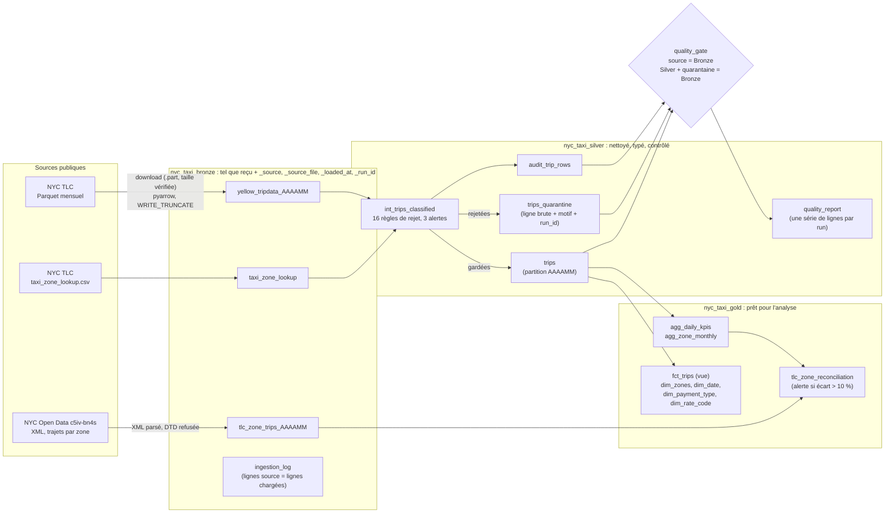

# GCP Taxi Pipeline

> Pipeline ELT NYC Yellow Taxi sur BigQuery Sandbox, à 0 € : architecture
> médaillon Bronze / Silver / Gold, ingestion Parquet, CSV et XML, quarantaine
> des lignes rejetées, rapport de qualité par run, DAG Airflow 3, dbt
> incrémental par mois et CI GitHub Actions sans secret. Exécuté en local
> (Docker) uniquement.

Pipeline data engineering sur Google Cloud Platform, sans compte de facturation
(BigQuery Sandbox) et sans clé de service account : ingestion des fichiers
publics NYC TLC et d'un jeu XML NYC Open Data, couches Bronze / Silver / Gold
construites et testées par dbt, contrôle de réconciliation, orchestration
Airflow, plus une voie PySpark comparée à BigQuery et un nettoyage Excel VBA
du référentiel des zones.

Documentation détaillée :
- [docs/exploitation.md](docs/exploitation.md) : lancer, relancer un mois,
  reprise sur erreur, ajouter une source, traiter la quarantaine,
  reconstruction après expiration ;
- [docs/modele_de_donnees.md](docs/modele_de_donnees.md) : colonnes de chaque
  table, par couche ;
- [docs/qualite.md](docs/qualite.md) : chaque règle de rejet et d'alerte, sa
  justification et ses comptes mesurés.

## Problème

Les données NYC TLC sont publiées chaque mois en Parquet (3,5 à 4,1 millions de
trajets par mois en 2025), avec des lignes inexploitables : montants négatifs
ou aberrants, trajets qui finissent avant de commencer, durées ou distances
impossibles, totaux incohérents. Le pipeline doit :
1. charger un mois sans jamais le dupliquer, même relancé ;
2. le modéliser pour l'analyse (table de faits et dimensions) en écartant les
   lignes invalides, **en comptant chaque ligne écartée et sa raison** ;
3. prouver qu'aucun trajet n'est perdu entre le brut et la table de faits ;
4. rester à 0 €, sans clé, sur une Sandbox qui refuse les requêtes DML et
   expire les tables après 60 jours.

## Architecture



Deux DAG Airflow, lancés à la main (`schedule=None`) :
- `nyc_taxi_elt` (médaillon) : `check_source → download → load_bronze,
  load_bronze_zones, load_bronze_tlc_xml → dbt_seed → dbt_run → dbt_test →
  quality_gate`, un mois par run, paramètres `year` / `month`. Le `run_id`
  Airflow est écrit dans chaque couche (Bronze `_run_id`, quarantaine,
  audit, rapport). Détails :
  [Médaillon dbt et DAG `nyc_taxi_elt`](#médaillon-dbt-et-dag-nyc_taxi_elt).
- `nyc_taxi_pipeline` (historique, dataset `nyc_taxi`) : chargement dans
  `yellow_tripdata_raw`, `sql/01-03`, puis les 20 tests dbt de ces tables. Il
  alimente le dashboard Looker Studio et la comparaison PySpark.

Pas de Cloud Storage : GCS exige un compte de facturation lié, même dans
l'offre gratuite. Le chargement part donc d'un fichier local, converti en
Parquet par pyarrow avec les colonnes d'ingestion.

**Pas de source PostgreSQL** : les sources publiques utilisées sont publiées
en Parquet, CSV et XML ; aucune base PostgreSQL n'est simulée.

## Résultats mesurés

Toutes les mesures viennent d'exécutions locales (Docker sur une machine
Windows) contre la Sandbox BigQuery, sous l'identité du compte de service
`taxi-pipeline` (impersonation). Une seule mesure par cas : les durées sont un
ordre de grandeur. Les tables expirent après 60 jours ; ces chiffres restent
ici, datés, pour rester vérifiables (reconstruction : `scripts/rebuild_after_expiry.sh`).

**Médaillon, DAG `nyc_taxi_elt`, 2026-10-30 (janvier) et 2026-10-31 (février,
mars, relance de janvier)** :

| Mois | Source (Parquet) | Bronze | `silver.trips` | Quarantaine | Taux de rejet | Zones en alerte XML | Tests dbt | Contrôle qualité | Durée |
|---|---:|---:|---:|---:|---:|---:|---|---|---:|
| 2025-01 | 3 475 226 | 3 475 226 | 3 250 924 | 224 302 | 6,45 % | 28 | 60 PASS + 1 WARN / 61 | passé | 221 s |
| 2025-02 | 3 577 543 | 3 577 543 | 3 304 922 | 272 621 | 7,62 % | 30 | 60 PASS + 1 WARN / 61 | passé | 315 s |
| 2025-03 | 4 145 257 | 4 145 257 | 3 825 380 | 319 877 | 7,72 % | 43 | 60 PASS + 1 WARN / 61 | passé | 548 s |
| **Total** | **11 198 026** | **11 198 026** | **10 381 226** | **816 800** | **7,29 %** | | | | |

- Silver + quarantaine = Bronze = source, chaque mois, à la ligne près
  (contrôle bloquant du `quality_gate` et test dbt).
- Quarantaine par motif sur 3 mois : tarif invalide 487 656, distance invalide
  294 767, durée nulle 27 063, durée > 6 h 3 709, vitesse > 100 mph 2 133,
  total < tarif + pourboire 777, composant négatif 311, dropoff avant pickup
  298, pickup hors du mois du fichier 86. Sept règles à 0 (horodatage
  manquant, zone, paiement, code tarifaire ou fournisseur inconnu, doublons
  exacts ou de clé métier), chacune vérifiée par un test unitaire. Détail
  par mois : [docs/qualite.md](docs/qualite.md).
- Alertes gardées en Silver (janvier / février / mars) : zone inconnue
  25 485 / 22 419 / 24 987, nombre de passagers nul, 0 ou > 6
  436 475 / 649 069 / 747 163, trajet de moins de 60 s 8 839 / 8 452 / 10 790.
- **Idempotence** : instantané des trois mois, relance complète de janvier
  (237 s), comparaison : `[idempotence] OK: no difference over 3 month(s)`.
  Lignes Bronze, lignes Silver, quarantaine par motif et empreinte
  (`BIT_XOR` des `trip_id`) de Silver et de la quarantaine identiques, pour
  janvier comme pour février et mars.
- **Contrôle XML** (informatif, non bloquant) : seuil 10 % d'écart et 1 000
  trajets. Les 1 WARN dbt sont ce contrôle. Les zones 264 et 265 (« Unknown »)
  sont en alerte chaque mois, la TLC ne les publiant pas.
- **Stockage, 2026-10-31** : 5,81 Go sur 10 Go (Bronze 2,74 Go, Silver
  2,14 Go, Gold < 1 Mo, chaîne historique `nyc_taxi` 0,94 Go).
- Durées : commande `airflow dags test` complète, une mesure par mois ; elles
  ne suivent pas le volume (mars 548 s pour 16 % de lignes de plus que
  février).

**Historique : schéma en étoile, DAG `nyc_taxi_elt`, 2026-10-26** (dataset
unique `nyc_taxi`, 8 règles d'exclusion ; remplacé par le médaillon, tables
supprimées le 2026-10-31) :

| Mois | Durée du run | Lignes brutes | Dans `fct_trips` | Écartées | Tests dbt | Contrôle qualité |
|---|---|---|---|---|---|---|
| 2025-01 | 205 s | 3 475 226 | 3 253 021 | 222 205 (6,4 %) | 41/41 | vert |
| 2025-02 | 234 s | 3 577 543 | 3 310 026 | 267 517 (7,5 %) | 41/41 | vert |
| 2025-03 | 184 s | 4 145 257 | 3 847 686 | 297 571 (7,2 %) | 41/41 | vert |

- Fichiers déjà présents en local pour ces trois runs (téléchargement sauté).
  Un run de mars téléchargement compris : 211 s.
- Relancer un mois redonnait les mêmes comptes à la ligne près, sans toucher
  aux autres mois (vérifié sur les trois mois).
- `fct_trips` : 10 410 733 trajets sur 3 mois, 1,87 Go. Dataset complet
  (toutes tables, deux chaînes) : 4,38 Go, sous les 10 Go de la Sandbox.
- Principales exclusions en janvier : tarif invalide 129 637, distance
  invalide 90 994, durée > 6 h 1 203, total < tarif + pourboire 225, trajet
  d'un autre mois 22, dropoff avant pickup 124. Aucun horodatage manquant,
  aucun doublon exact.

Du schéma en étoile au médaillon, les 8 anciennes règles donnent les mêmes
comptes ; les 8 règles ajoutées écartent 2 097 lignes de plus en janvier
(durée nulle 1 232, vitesse > 100 mph 764, composant négatif 101), 5 104 en
février et 22 306 en mars. D'où `silver.trips` = 3 250 924 / 3 304 922 /
3 825 380 contre 3 253 021 / 3 310 026 / 3 847 686 dans l'ancien `fct_trips`.

**CI GitHub Actions** (sans secret) : lint SQL, `dbt parse`, `dbt compile` et
pytest, dont l'import réel des deux DAG. Les tests dbt, eux, tournent en
local contre BigQuery (voir
[Ce que vérifie la CI](#ce-que-vérifie-la-ci-et-ce-quelle-ne-vérifie-pas)).

**Chaîne historique, 2026-10-16** (janvier 2025, DAG `nyc_taxi_pipeline`, puis
`spark/spark_transform.py` et `spark/compare_with_bigquery.py`) :

| Mesure | Valeur |
|---|---|
| Lignes brutes chargées (`yellow_tripdata_raw`) | 3 475 226 |
| Lignes conservées (`trips_clean`) | 3 253 304 |
| Jours dans `daily_kpis` | 33 (31/12/2024 → 01/02/2025, horodatages de bord de mois) |
| `trips_clean` BigQuery vs PySpark | 3 253 304 lignes de part et d'autre |
| `daily_kpis` BigQuery vs PySpark | 5/5 contrôles OK, tolérance 0,5 % (revenu total 87 219 707,12 $ des deux côtés) |
| Tests dbt | 20/20 PASS (relancés le 2026-10-26 : 20/20) |

Les deux chaînes n'appliquent pas exactement les mêmes règles (le médaillon
écarte aussi les trajets hors du mois du fichier, les totaux incohérents, les
durées nulles, les vitesses impossibles et les composants négatifs) :
3 253 304 lignes gardées pour janvier par la chaîne historique et 3 250 924
par le médaillon ne sont pas comparables au trajet près.

## Choix de conception

- **BigQuery Sandbox, sans facturation.** Coût nul garanti
  (`billingEnabled: False`), au prix des limites listées plus bas.
- **Un dataset par couche** (`nyc_taxi_bronze`, `nyc_taxi_silver`,
  `nyc_taxi_gold`), créés une fois par le propriétaire du projet : le compte
  de service n'a que `WRITER` sur ces trois datasets et sur `nyc_taxi`, et ne
  peut pas créer de dataset. Le nom des datasets se change par variable
  d'environnement (`BQ_BRONZE_DATASET`, `BQ_SILVER_DATASET`, `BQ_GOLD_DATASET`).
- **Bronze écrit par Python, pas par dbt.** Chaque source est chargée telle
  que reçue, plus quatre colonnes d'ingestion (`_source`, `_source_file`,
  `_loaded_at`, `_run_id`). Le chargement compare les lignes de la source aux
  lignes de la table et l'écrit dans `ingestion_log` ; un écart fait échouer
  la tâche (`BronzeCountError`).
- **Quarantaine plutôt que filtre.** Une ligne rejetée n'est ni supprimée ni
  corrigée : elle part dans `trips_quarantine`, colonnes d'origine, avec la
  première règle enfreinte et le `run_id`. Les alertes (zone inconnue,
  passagers, trajet très court) gardent la ligne et posent un indicateur.
- **Incrémental sans DML.** La Sandbox refuse `INSERT`, `DELETE` et `MERGE`
  (erreur 403 mesurée). `trips`, `trips_quarantine`, `audit_trip_rows` et les
  agrégats utilisent `insert_overwrite` avec `copy_partitions` : un mois
  remplace sa partition par une copie de table. Le rapport de qualité et le
  journal d'ingestion sont ajoutés par load job `WRITE_APPEND`, vérifié
  autorisé sur une table jetable le 2026-10-30.
- **Partition par entier `AAAAMM`, pas par date** : le dataset expire les
  partitions de date de plus de 60 jours, ce qui effacerait des données de
  2025 dès leur écriture.
- **Une table Bronze par mois**, en écrasement : un chargement Parquet ne peut
  pas ajouter de colonne de partition, et le DML est interdit. dbt lit tous
  les mois par la table joker `yellow_tripdata_*`.
- **Contrôle XML externe et non bloquant.** Les comptes publiés par la TLC
  (`c5iv-bn4s`) viennent après un filtrage TLC que nous ne connaissons pas :
  un écart signale un sujet à regarder, il ne prouve pas une erreur. Le test
  a la sévérité `warn`.
- **Authentification ADC / impersonation**, aucune clé dans le dépôt ni dans
  l'historique (test anti-fuite en CI).
- **Test « total = somme des composants » écarté** après mesure sur le fichier
  brut ; remplacé par « total ≥ tarif + pourboire ». Détails dans
  [Médaillon dbt](#médaillon-dbt-et-dag-nyc_taxi_elt).
- **Portabilité DuckDB mesurée puis écartée** (sur l'ancien schéma en étoile,
  8 modèles). Les modèles inchangés ont été lancés avec dbt-duckdb 1.11.0
  (DuckDB 2.0.0) sur 10 000 trajets : **3 modèles sur 8** tournaient tels
  quels (`dim_zones`, `dim_payment_type`, `dim_rate_code`). Les 5 autres
  échouaient sur la table joker et `_table_suffix`, la config de partition
  BigQuery, et des fonctions absentes de DuckDB (`farm_fingerprint`,
  `to_json_string`, `format_timestamp`, `timestamp_diff`, `safe_divide`,
  `generate_date_array`, `format_date`). Piège silencieux : `extract(dayofweek)`
  tourne sur DuckDB mais y numérote le dimanche 0 (1 sur BigQuery), donc
  `is_weekend` serait faux sans erreur. Le projet ne supporte que BigQuery.

## Limites connues

- **Exécution locale uniquement.** Les DAG ont tourné par `airflow dags test`
  dans un conteneur Docker, sans scheduler permanent ni surveillance.
- **Expiration des tables (Sandbox, 60 jours).** Relevé le 2026-10-31 :
  `yellow_tripdata_raw` expire le **16/11/2026** ; `taxi_zones` le
  22/12/2026 ; `trips_clean` et `daily_kpis`, lues par Looker Studio et
  `spark/compare_with_bigquery.py`, le **23/12/2026** ; les tables du
  médaillon les 29 et 30/12/2026. Reconstruction de tout en une commande :
  `scripts/rebuild_after_expiry.sh`. Détails :
  [Expiration Sandbox et rechargement](#expiration-sandbox-et-rechargement).
- **Les tests dbt ne tournent pas en CI**, seulement en local contre
  BigQuery. La CI compile avec des identifiants factices et n'interroge
  jamais BigQuery.
- **Comptes XML révisés par la TLC** : une reconstruction ultérieure peut
  donner d'autres alertes, alors que les comptes Parquet restent les mêmes
  tant que la TLC ne republie pas ses fichiers.
- **Pas de source PostgreSQL** (voir [Architecture](#architecture)).
- **Plage de mois : 2024 à 2026**, celle de `dim_date`. Au-delà, il faut
  élargir `dim_date` et le paramètre du DAG ensemble.
- **Versions testées : Python 3.11** et Airflow 3.3.2 (image Docker, CI).
  Python 3.13 est supporté par Airflow 3.3.2 mais n'a pas été testé.
- **Octets traités par les relances incrémentales non mesurés** : dbt ne les
  rapporte pas pour les copies de partition.
- **Taxe CBD non chargée** (`cbd_congestion_fee`, apparue en 2025) : le
  contrat de schéma Bronze ne la contient pas.
- Un run incrémental qui échoue peut laisser une table temporaire
  `__dbt_tmp` (observé pendant l'essai Sandbox, expiration 12 h).
- Durées issues d'une seule mesure par cas, sur une seule machine.

## Pourquoi ce dataset

[NYC Yellow Taxi Trip Records](https://www.nyc.gov/site/tlc/about/tlc-trip-record-data.page) :
dataset public, mis à jour mensuellement, volumétrie idéale pour un projet gratuit
(~60-70 Mo par mois en Parquet, 3,5 à 4,1 M lignes en 2025) : assez réaliste
pour manipuler du vrai volume, assez petit pour tenir sous les quotas gratuits.

## Pourquoi BigQuery Sandbox (et pas GCS + billing)

BigQuery propose un mode "Sandbox" utilisable **sans compte de facturation**,
avec ces limites :
- les tables et partitions expirent automatiquement après 60 jours
- pas de DML (`INSERT`, `DELETE` et `MERGE` refusés, mesuré le 2026-10-26),
  pas de streaming insert, pas de requêtes planifiées
- 10 Go de stockage et 1 To de requêtes traitées par mois inclus

## Coût réel

**0 €.** Aucune carte bancaire liée au projet.

| Ressource | Utilisé (mesuré) | Quota gratuit Sandbox |
|---|---|---|
| Stockage BigQuery, 4 datasets, 2026-10-31 (après les 3 mois du médaillon) | 5,81 Go | 10 Go |
| Stockage BigQuery, dataset `nyc_taxi`, 2026-10-26 (schéma en étoile, historique) | 4,38 Go | 10 Go |
| Requêtes `sql/01-03` (chaîne historique, une exécution, 2026-10-16) | ~1,3 Go traités (793 + 329 + 186 Mo) | 1 To/mois |
| Premier `dbt run` du schéma en étoile (janvier, 2026-10-26) | 469,2 Mio par modèle incrémental (rapporté par dbt) | 1 To/mois |
| Dry run des modèles médaillon de janvier (2026-10-30) | `trips` 492,0 Mo, `trips_quarantine` 780,4 Mo, `audit_trip_rows` 492,0 Mo | 1 To/mois |

Détail du stockage au 2026-10-31 (`__TABLES__`, `size_bytes`) : Bronze
2,743 Go (`yellow_tripdata_202501` 856,9 Mo, `_202502` 873,3 Mo, `_202503`
1 012,5 Mo), Silver 2,136 Go (`trips` 1 898,9 Mo, `trips_quarantine`
237,1 Mo), Gold < 1 Mo, `nyc_taxi` 0,935 Go (`yellow_tripdata_raw` 492,0 Mo,
`trips_clean` 443,2 Mo). Une table Bronze pèse plus que la table brute
historique du même mois (856,9 contre 492,0 Mo en janvier) : ce sont les
quatre colonnes d'ingestion, répétées sur chaque ligne.

Les chargements (load jobs) et les copies de partition ne sont pas facturés
en volume de requêtes.

## Chaîne historique : volumétrie et qualité

- Source : `yellow_tripdata_2025-01.parquet`, ~59 Mo, 3 475 226 lignes brutes
- Après nettoyage (`trips_clean`) : 3 253 304 lignes (94 % conservées)
- Anomalies exclues : montants négatifs (144 118), trajets dropoff < pickup
  (124), distances > 200 mi (122), durées > 6 h (1 167)

`sql/01_data_quality_checks.sql` vérifie avant transformation les valeurs
nulles, les doublons exacts (`TO_JSON_STRING`) et la cohérence métier. Résultat
sur janvier 2025 : 0 valeur nulle, 0 doublon, anomalies métier minoritaires
(~6 % des lignes), filtrées dans `trips_clean`.

## Reproduction

Prérequis : un projet GCP, `gcloud` CLI authentifié (ADC), Docker.

**Médaillon**, testé en Python 3.11 dans l'image
`apache/airflow:3.3.2-python3.11`. Une fois : ADC en impersonation, création
des trois datasets et droits du compte de service (commandes dans
[docs/exploitation.md](docs/exploitation.md#prérequis-une-fois)).

```bash
docker compose -f airflow/docker-compose.yml build
# un run par mois (années 2024 à 2026)
for m in 1 2 3; do
  docker compose -f airflow/docker-compose.yml run --rm airflow bash -c \
    "airflow db migrate && airflow dags test nyc_taxi_elt --conf '{\"year\": 2025, \"month\": $m}'"
done

# ou tout reconstruire (chaîne historique, taxi_zones, médaillon) en une commande
scripts/rebuild_after_expiry.sh
```

Sous Linux/macOS, définir `GCLOUD_CONFIG_DIR=~/.config/gcloud` avant
`docker compose` ; sous Git Bash, préfixer par `MSYS_NO_PATHCONV=1`. Sans
Airflow : voir [docs/exploitation.md](docs/exploitation.md#lancer-un-mois).

**Chaîne historique** (Python 3.11-3.13 ; pyarrow n'avait pas de wheel pour
3.14 au moment de l'écriture) :

```bash
# 1. Setup GCP (une fois)
gcloud services enable bigquery.googleapis.com --project=<PROJECT_ID>
bq mk --dataset --location=US <PROJECT_ID>:nyc_taxi
gcloud auth application-default login   # credentials pour le SDK Python

# 2. Environnement Python
python -m venv venv
venv\Scripts\activate      # (Windows) — source venv/bin/activate sous Linux/Mac
pip install -r requirements.txt

# 3. Ingestion + chargement
python ingestion/download_taxi_data.py --year 2025 --month 1
set GCP_PROJECT_ID=<PROJECT_ID>
python ingestion/load_to_bigquery.py --file data/yellow_tripdata_2025-01.parquet

# 4. Transformation (bq CLI ou console BigQuery)
bq query --use_legacy_sql=false < sql/01_data_quality_checks.sql
bq query --use_legacy_sql=false < sql/02_transform_trips_clean.sql
bq query --use_legacy_sql=false < sql/03_analytics_daily_kpis.sql
```

Configuration : copier `.env.example` vers `.env` et ajuster `GCP_PROJECT_ID`.
Pour exécuter le pipeline en moindre privilège (service account dédié, sans
clé), voir [Sécurité & gouvernance des accès](#sécurité--gouvernance-des-accès).
Le fichier `.env` et toute clé de service ne sont jamais commités (`.gitignore`).

## Dashboard Looker Studio

1. https://lookerstudio.google.com → "Créer" → "Source de données" → BigQuery
2. Sélectionner le projet → dataset `nyc_taxi` → table `daily_kpis`
3. Construire le rapport avec au minimum :
   - Série temporelle : `trip_count` par `pickup_date`
   - Indicateur : `revenue_usd` total sur la période
   - Graphique : `avg_tip_pct` par `pickup_weekday`

Looker Studio est gratuit sans limite liée à ce projet (facturé uniquement le
volume de requêtes BigQuery sous-jacent, déjà comptabilisé ci-dessus).

## PySpark local (voie alternative)

Le pipeline BigQuery ci-dessus reste la voie principale (SQL managé, dashboard
Looker Studio). `spark/` ajoute une **voie alternative en parallèle**, sur les
mêmes données Parquet locales : elle reproduit les 3 mêmes étages (contrôle
qualité → `trips_clean` → `daily_kpis`) avec la DataFrame API PySpark plutôt
qu'en SQL BigQuery, en local (`local[*]`, sans cluster ni service Spark
managé). Objectif : démontrer la même logique de traitement de données avec un
moteur de traitement distribué (Spark), en complément du SQL managé — utile
pour comparer les deux approches ou repartir sur un moteur non-SQL si le
volume dépassait un jour les quotas Sandbox.

Prérequis : Java 17+ (requis par Spark), en plus de l'environnement Python
déjà utilisé pour l'ingestion (`pip install -r requirements.txt` installe
aussi `pyspark`).

```bash
# Transformation (lit data/yellow_tripdata_2025-01.parquet par défaut)
python spark/spark_transform.py --file data/yellow_tripdata_2025-01.parquet

# Equivalent avec spark-submit
spark-submit spark/spark_transform.py --file data/yellow_tripdata_2025-01.parquet
```

Écrit `data/spark_output/trips_clean.parquet` et `data/spark_output/daily_kpis.parquet`
(non commités, voir `.gitignore`).

### Vérification d'équivalence avec BigQuery

`spark/compare_with_bigquery.py` compare le nombre de lignes de `trips_clean`
et les agrégats clés de `daily_kpis` (nombre de jours, volume total de
courses, revenu total, tip % moyen) entre la sortie PySpark locale et les
tables BigQuery correspondantes, avec une tolérance de 0.5 % (arrondis
différents entre les deux moteurs). Ce script s'exécute en standalone, hors
pytest (il a besoin de BigQuery et de la sortie Spark), et retourne un code de
sortie non nul si un écart dépasse la tolérance :

```bash
# Nécessite le pipeline BigQuery déjà exécuté (étape 4) et spark_transform.py
# déjà exécuté (étape ci-dessus), avec le même GCP_PROJECT_ID que .env
python spark/compare_with_bigquery.py
```

## Tests de qualité : dbt

`dbt/` est un projet dbt (`dbt-bigquery`) en deux parties. Cette section décrit
la première : il déclare les 3 tables produites par `sql/01-03` comme
**sources** et les teste (dbt sert ici de contrôle qualité en aval de `sql/`).
La seconde, le médaillon, est décrite dans
[Médaillon dbt et DAG `nyc_taxi_elt`](#médaillon-dbt-et-dag-nyc_taxi_elt).

| Table | Tests |
|---|---|
| `yellow_tripdata_raw` | `not_null` sur pickup/dropoff |
| `trips_clean` | `not_null` (dates, `pickup_date`, zones) ; `trip_distance` > 0 et ≤ 200 ; `fare_amount` entre 0 et 1000 ; `pickup_date` entre 2024-01-01 et 2025-12-31 ; `pickup_weekday` ∈ jours de la semaine ; dropoff ≥ pickup et durée ≤ 6 h |
| `daily_kpis` | `unique` + `not_null` sur `pickup_date` (clé) ; `trip_count` et `revenue_usd` non nuls et > 0 ; réconciliation `SUM(trip_count)` = `COUNT(*)` de `trips_clean` |

Les seuils reprennent les règles de filtrage de `sql/02_transform_trips_clean.sql`.
`trips_clean` n'a pas de clé naturelle (aucun identifiant de course dans la
source TLC) : pas de test `unique` sur cette table.

Authentification : `method: oauth` dans `dbt/profiles.yml`, c'est-à-dire ADC
(le même `gcloud auth application-default login` que le reste du pipeline),
sans clé JSON.

```bash
# dbt dans un venv séparé (évite les conflits de dépendances)
py -3.11 -m venv .venv-dbt
.venv-dbt\Scripts\pip install dbt-core==1.12.6 dbt-bigquery==1.12.1

set GCP_PROJECT_ID=<PROJECT_ID>
.venv-dbt\Scripts\dbt test --select source:nyc_taxi --project-dir dbt --profiles-dir dbt
# Résultat obtenu le 2026-10-16 : Done. PASS=20 WARN=0 ERROR=0 SKIP=0 TOTAL=20
# (relancé le 2026-10-26 avec --select source:nyc_taxi : PASS=20)
```

## Orchestration : Airflow

`airflow/dags/nyc_taxi_pipeline.py` enchaîne tout le pipeline :

```
check_source_available → ingest → sql_quality_checks → sql_trips_clean → sql_daily_kpis → dbt_test
```

- `check_source_available` : requête HTTP `HEAD` sur le fichier public NYC TLC
  du mois demandé ; la tâche échoue si le fichier n'est pas encore publié.
- `ingest` : réutilise `download_taxi_data.py` et `load_to_bigquery.py`.
- `sql_*` : exécute `sql/01`, `02`, `03` tels quels via le client BigQuery
  (les résultats des contrôles qualité de `sql/01` sont écrits dans le log).
- `dbt_test` : lance `dbt test --select source:nyc_taxi` (les 20 tests des
  tables `sql/01-03` ; le médaillon est testé par le DAG `nyc_taxi_elt`).

Paramètres `year` / `month` (défaut 2025 / 1), déclenchement manuel
(`schedule=None`).

Airflow ne s'exécute pas nativement sous Windows. `airflow/docker-compose.yml`
fournit un environnement minimal : un seul conteneur `apache/airflow:3.3.2`,
base SQLite, dbt installé dans un venv séparé, repo monté sur `/opt/pipeline`,
et répertoire gcloud de l'hôte monté **en lecture seule** pour ADC (aucune clé).

```bash
docker compose -f airflow/docker-compose.yml build

# Validation + exécution complète d'un run, sans scheduler
docker compose -f airflow/docker-compose.yml run --rm airflow bash -c \
  "airflow db migrate && airflow dags reserialize && airflow dags list && airflow dags test nyc_taxi_pipeline 2025-01-01"

# UI (dev) sur http://localhost:8080
docker compose -f airflow/docker-compose.yml up
```

Sous Linux/macOS, définir `GCLOUD_CONFIG_DIR=~/.config/gcloud` avant `docker compose`.

Exécuté le 2026-10-16 (`airflow dags test nyc_taxi_pipeline 2025-01-01`) :
les 6 tâches sont en succès, avec le HEAD TLC → 200 (59 158 238 octets),
3 475 226 lignes chargées, `sql/01-03` OK et `dbt test` PASS=20.

## Médaillon dbt et DAG `nyc_taxi_elt`

Deuxième chaîne, indépendante de la première (qui reste inchangée) : un mois
à la fois, des sources publiques jusqu'à la couche Gold, construite et testée
par dbt.

```
check_source → download → load_bronze, load_bronze_zones, load_bronze_tlc_xml
             → dbt_seed → dbt_run → dbt_test → quality_gate
```

- `load_bronze*` : `ingestion/bronze.py` (Parquet des trajets, CSV des zones)
  et `ingestion/tlc_zone_trips_xml.py` (XML NYC Open Data). Écrasement
  (`WRITE_TRUNCATE`), colonnes d'ingestion, compte vérifié et journalisé.
- `dbt_run` : Silver (`stg_*` vues sur Bronze, `int_trips_classified` qui
  attribue à chaque ligne la première règle enfreinte, `trips`,
  `trips_quarantine`, `audit_trip_rows`) puis Gold (`fct_trips`, `dim_*`,
  `agg_daily_kpis`, `agg_zone_monthly`, `tlc_zone_reconciliation`).
  15 modèles et 3 seeds.
- `dbt_test` : les **61 tests du médaillon** (`--exclude source:nyc_taxi`),
  soit 55 tests génériques (unique, not_null, relationships, accepted_values,
  bornes) et 6 tests métier : Silver + quarantaine = Bronze, quarantaine =
  audit, règles de trajet revérifiées sur Silver, total ≥ tarif + pourboire,
  zones Bronze = zones Silver, et le contrôle XML (sévérité `warn`, seul test
  non bloquant). Par modèle : `trips` 12, `audit_trip_rows` 6, `fct_trips` 5,
  `trips_quarantine` 5, `agg_daily_kpis` 4, `dim_zones` 4, `dim_date` 3,
  `dim_payment_type` 3, `dim_rate_code` 3, `stg_tlc_zone_trips` 3,
  `agg_zone_monthly` 2, `stg_taxi_zone_lookup` 2, `tlc_zone_reconciliation` 2,
  `stg_yellow_trips` 1.

  S'y ajoutent **21 tests unitaires dbt** (`dbt/models/silver/_int_trips_classified__unit_tests.yml`) :
  une ligne fictive par règle de rejet (16, dont les 7 qui n'ont rejeté
  aucune ligne réelle) et par alerte (3), plus une course valide et un code
  tarifaire nul gardés. Chacun vérifie le motif ou l'indicateur attribué.
  Détail : [docs/qualite.md](docs/qualite.md#tests-unitaires-des-règles).
  `dbt_test` lance donc 82 tests ; mesuré le 2026-10-31 sur janvier : PASS =
  81, WARN = 1 (contrôle XML), ERROR = 0. Les runs du tableau
  [Résultats mesurés](#résultats-mesurés) sont antérieurs aux tests unitaires
  (61 tests).

  Le projet dbt compte **81 tests de données et 21 tests unitaires, 102 au
  total** (`dbt compile` en CI : `81 data tests, 21 unit tests`) : les 61 et
  21 du médaillon, plus les 20 tests historiques
  sur `yellow_tripdata_raw`, `trips_clean` et `daily_kpis`, lancés par le DAG
  `nyc_taxi_pipeline` (`--select source:nyc_taxi`).
- `quality_gate` : `quality/quality_gate.py` vérifie source = Bronze, Bronze
  = audit, gardées = Silver, rejets par motif = quarantaine, Silver +
  quarantaine = Bronze, et que la quarantaine du mois porte le `run_id` du run.
  Il écrit le rapport dans `nyc_taxi_silver.quality_report` **avant** de
  conclure, y compris en cas d'échec.
- `quality/idempotence.py` : instantané (`snapshot`) puis comparaison
  (`compare`) de tous les mois, pour prouver qu'une relance ne change rien.

Règles, seuils et justification : [docs/qualite.md](docs/qualite.md).

**Incrémental sans DML.** La Sandbox refuse `INSERT`, `DELETE` et `MERGE`
(erreur 403 mesurée le 2026-10-26). Les tables Silver et Gold mensuelles sont
donc partitionnées par un entier `AAAAMM` et reconstruites en
`insert_overwrite` avec `copy_partitions` : relancer un mois remplace sa
partition par une copie de table, sans toucher aux autres mois. Pas de
partition par date : le dataset expire les partitions de plus de 60 jours, ce
qui effacerait des données de 2025 dès leur écriture.

**Test remplacé.** Un premier test exigeait `total_amount` = somme des
composants (tarif, extra, taxe MTA, pourboire, péages, surcharges). Il
échouait sur 2 395 452 trajets de janvier 2025. Mesure sur le fichier brut
(3 475 226 lignes) : 2 564 195 lignes s'écartent de plus d'un centime, et
encore 1 111 807 après avoir ajouté la taxe CBD (`cbd_congestion_fee`, non
chargée par ce projet). Les écarts les plus fréquents valent +2,50 $
(396 358 lignes), −3,25 $ (391 172) et −2,50 $ (176 749), soit la surtaxe de
congestion et la taxe CBD comptées en double ou absentes selon les
enregistrements. C'est la façon dont le fichier TLC est rempli, pas une erreur
du pipeline : ce test n'est pas gardé. Il est remplacé par la règle
« total ≥ tarif + pourboire » (`invalid_total`, 225 trajets en janvier),
vérifiée par un test bloquant.

**Plage de mois acceptée** : le DAG n'accepte que les années 2024 à 2026,
c'est-à-dire la plage de `dim_date` (vars `dim_date_start` / `dim_date_end`).
Un mois de 2027 ferait échouer le test `relationships` de `pickup_date` vers
`dim_date` ; pour l'accepter, élargir les deux ensemble (un test pytest
vérifie qu'ils restent égaux).

**Versions réellement testées** : Python 3.11 (image
`apache/airflow:3.3.2-python3.11` pour le DAG, venv dbt local, CI) avec
Airflow 3.3.2, dbt-core 1.12.6 et dbt-bigquery 1.12.1. Airflow 3.3.2 supporte
officiellement Python 3.10 à 3.14, mais **Python 3.13 n'a pas été testé** pour
ce pipeline.

Le téléchargement écrit dans `<fichier>.part`, vérifie la taille reçue contre
`Content-Length`, puis renomme : une coupure ne laisse jamais de Parquet
tronqué qu'une relance réutiliserait (`tests/test_download_taxi_data.py`).

### Ce que vérifie la CI (et ce qu'elle ne vérifie pas)

GitHub Actions (`.github/workflows/ci.yml`) tourne sans aucun secret ni accès
à BigQuery. Elle vérifie seulement :
- le lint SQL (`sqlfluff lint dbt/models dbt/tests`) ;
- `dbt parse` et `dbt compile`. dbt-bigquery exige des identifiants pour
  créer son client, même pour compiler : la CI lui donne des **identifiants
  factices** (un fichier ADC aux valeurs `ci-dummy`, écrit dans le dossier
  temporaire du runner), et `--no-populate-cache --no-introspect` l'empêchent
  d'envoyer la moindre requête. **Le compile en CI n'interroge jamais
  BigQuery** ; il vérifie que les 15 modèles, 81 tests de données et 21 tests unitaires
  se rendent en SQL ;
- pytest (60 tests), dont l'import réel des deux DAG par le `DagBag`
  d'Airflow 3.3.2, l'ingestion Bronze et XML, le contrôle qualité et
  l'idempotence sur un faux client BigQuery.

**Les 82 tests dbt du médaillon (dont les 21 unitaires) ne tournent pas en
CI** : un test unitaire dbt s'exécute aussi sur BigQuery. Ils tournent en
local contre BigQuery (`dbt test` ou tâche `dbt_test` du DAG), comme les
exécutions du DAG. Un modèle qui compile en CI peut donc encore échouer sur
BigQuery.

### Expiration Sandbox et rechargement

Toute table expire 60 jours après sa dernière création ou son dernier
remplacement (réglage par défaut de la Sandbox) ; les datasets restent. Dates
relevées le 2026-10-31 :

| Table(s) | Expire le | Lue par |
|---|---|---|
| `yellow_tripdata_raw` | 16/11/2026 | `sql/01-02`, test dbt `source:nyc_taxi` |
| `taxi_zones` | 22/12/2026 | exemple de jointure ci-dessous |
| `trips_clean`, `daily_kpis` | 23/12/2026 | dashboard Looker Studio, `spark/compare_with_bigquery.py` |
| tables Bronze, Silver et Gold du médaillon | 29 et 30/12/2026 | DAG `nyc_taxi_elt` |

Conséquences si rien n'est rechargé :
- après le 16/11, `sql/01-03` et le DAG `nyc_taxi_pipeline` ne peuvent plus
  reconstruire `trips_clean` ni `daily_kpis`, et le test dbt sur
  `yellow_tripdata_raw` échoue ;
- après le 23/12, le dashboard Looker Studio et
  `spark/compare_with_bigquery.py` cessent de fonctionner (tables absentes).

Rechargement de tout, en une commande (chaîne historique, `taxi_zones` depuis
le seed versionné, puis un run médaillon par mois) :

```bash
scripts/rebuild_after_expiry.sh                    # 2025-01 2025-02 2025-03
scripts/rebuild_after_expiry.sh --dry-run          # affiche les étapes sans rien lancer
```

Détails : [docs/exploitation.md](docs/exploitation.md#expiration-sandbox-et-reconstruction-complète).

## Référentiel des zones : nettoyage Excel VBA

Les trajets ne contiennent que des identifiants (`PULocationID`, `DOLocationID`).
Pour les traduire en quartiers, la TLC publie une table de référence,
[`taxi_zone_lookup.csv`](https://d37ci6vzurychx.cloudfront.net/misc/taxi_zone_lookup.csv)
(265 zones). Elle n'est pas homogène : les zones inconnues 264 et 265 utilisent
tantôt `Unknown`, tantôt `N/A`, et les exports retouchés à la main ajoutent des
espaces, des casses différentes ou des doublons.

Le module [`vba/TaxiZoneCleaner.bas`](vba/TaxiZoneCleaner.bas) (macro
`CleanTaxiZones`) automatise ce nettoyage en local, dans Excel :

| Règle | Exemple |
|---|---|
| Espaces : trim, espaces doubles, espaces insécables, tabulations | `" queens "` → `Queens` |
| Borough ramené à une orthographe unique | `BRONX`, `the bronx` → `Bronx` |
| `service_zone` ramené à une orthographe unique | `yellow zone` → `Yellow Zone`, `airport` → `Airports` |
| Valeurs inconnues harmonisées | `N/A`, vide, `null` → `Unknown` |
| Séparateurs dans les noms de zone | `Allerton / Pelham Gardens` → `Allerton/Pelham Gardens` |
| Casse corrigée seulement si tout en majuscules ou tout en minuscules | `ALPHABET CITY` → `Alphabet City` (`JFK Airport` reste intact) |
| `LocationID` non numérique ou en double : ligne rejetée | `abc`, 2ᵉ ligne `4` |
| Signalés sans être modifiés : IDs manquants, borough inconnu, même nom de zone sur plusieurs IDs | `Corona` = 56 et 57 (légitime dans le fichier TLC) |

Sorties :
- feuille `zones_clean` : `location_id, borough, zone, service_zone, is_airport, is_unknown` ;
- feuille `zones_log` : chaque modification, rejet ou alerte (avant / après / règle) ;
- fichier `data/taxi_zone_lookup_clean.csv` (UTF-8 sans BOM), prêt pour BigQuery.

Utilisation :

```bash
curl -o data/taxi_zone_lookup.csv https://d37ci6vzurychx.cloudfront.net/misc/taxi_zone_lookup.csv
```

1. Créer un classeur Excel prenant en charge les macros (`.xlsm`) dans `vba/`
   (la macro cherche alors `../data/taxi_zone_lookup.csv`, sinon il ouvre un sélecteur de fichier).
2. `Alt+F11` → Fichier → Importer un fichier → `vba/TaxiZoneCleaner.bas`.
3. `Alt+F8` → `CleanTaxiZones` → Exécuter.

Pour essayer les règles, `vba/sample/taxi_zone_lookup_dirty.csv` contient
des défauts volontaires (choisir ce fichier dans le sélecteur).

Chargement dans BigQuery et jointure avec les trajets :

```bash
bq load --source_format=CSV --skip_leading_rows=1 --replace nyc_taxi.taxi_zones \
  data/taxi_zone_lookup_clean.csv \
  location_id:INTEGER,borough:STRING,zone:STRING,service_zone:STRING,is_airport:BOOLEAN,is_unknown:BOOLEAN
```

```sql
SELECT z.borough, COUNT(*) AS trips
FROM nyc_taxi.trips_clean t
JOIN nyc_taxi.taxi_zones z ON z.location_id = t.PULocationID
GROUP BY z.borough ORDER BY trips DESC;
```

Résultats mesurés le 2026-10-23 (macro exécutée dans Excel, puis `bq load`) :

| Fichier | Lignes lues | Gardées | Rejetées | Valeurs corrigées | Entrées du journal |
|---|---|---|---|---|---|
| `vba/sample/taxi_zone_lookup_dirty.csv` | 11 | 9 | 2 (ID `abc`, ID `4` en double) | 13 | 16 |
| `taxi_zone_lookup.csv` (TLC officiel) | 265 | 265 | 0 | 4 (`N/A` → `Unknown` sur 264 et 265) | 7 (4 corrections + 3 alertes « même zone » : `Corona` 56/57, `Governor's Island/Ellis Island/Liberty Island` 103/104/105) |

Dans BigQuery, `nyc_taxi.taxi_zones` contient 265 zones (2 inconnues, 3 aéroports).
La jointure avec `trips_clean` couvre les 3 253 304 trajets (0 sans zone) :
Manhattan 2 907 381, Queens 269 203, Brooklyn 55 453, Bronx 12 764,
Unknown 8 223, Staten Island 203, EWR 77.

Pour l'automatisation ou les tests, `CleanTaxiZoneFile(chemin)` fait le même
traitement sans boîte de dialogue et renvoie le résumé.

Seul le code `.bas` est versionné (texte lisible dans git), pas le classeur `.xlsm`.

## Sécurité & gouvernance des accès

### Analyse de risque

**Données traitées.** Uniquement le dataset public [NYC TLC Yellow Taxi](https://www.nyc.gov/site/tlc/about/tlc-trip-record-data.page),
déjà anonymisé par la source : pas de nom, pas de plaque, pas de coordonnées
GPS (les lieux sont des zones TLC `PULocationID`/`DOLocationID`). Aucune donnée
personnelle, aucune donnée client. Une fuite des tables n'exposerait rien qui
ne soit déjà téléchargeable publiquement.

**Ce qui est réellement à protéger** : l'accès au projet GCP, pas les données.
Si le projet était mal configuré :
- **clé de service account commitée** sur GitHub public : n'importe qui
  pourrait agir sur le projet avec les droits de ce compte (avec `owner` :
  modifier l'IAM, créer des ressources, supprimer les datasets) ;
- **identité du pipeline trop privilégiée** : un bug ou une erreur de
  manipulation (mauvais `GCP_PROJECT_ID`, `WRITE_TRUNCATE` sur la mauvaise
  table, `bq rm`) peut toucher tout le projet au lieu d'un seul dataset ;
- **dataset partagé en `allAuthenticatedUsers`** : sans gravité ici (données
  publiques), mais chaque requête d'un tiers consommerait le quota du projet.

**Ce qui limite déjà le risque :**
- **BigQuery Sandbox** : aucun compte de facturation lié
  (`gcloud billing projects describe` → `billingEnabled: false`). Un
  identifiant volé ne peut pas générer de coût, car les quotas gratuits sont un
  plafond dur et non un seuil de facturation. Les tables expirent après 60 jours.
- **ADC (Application Default Credentials)** : le code ne lit aucune clé
  (`bigquery.Client(project=...)` seulement). Les credentials restent dans le
  profil gcloud de l'utilisateur, hors du repo.
- **`.gitignore`** : `.env`, `service-account-key.json` et `*.json` sont exclus.
- **Contrôle automatisé** (`scripts/check_secrets.py`, voir plus bas) : aucune
  credential dans les fichiers suivis ni dans l'historique git.

### Audit de l'existant (2026-09-24)

`python iam/iam_setup.py audit` (lecture seule) sur `mini-siem-taxi-pipeline` :

```
[audit] ADC credential    : authorized_user
[audit] pipeline identity : user:<compte propriétaire du projet>
[audit] project roles     : ['roles/owner']
[audit] nyc_taxi ACL      : ['OWNER'] (+ inherited via projectOwners/projectWriters special groups)
[audit] service accounts  : none
[audit] FINDING: pipeline identity holds project admin role(s) ['roles/owner']: ...
[audit] FINDING: pipeline identity is OWNER of dataset nyc_taxi: ...
```

**Constat : oui, le pipeline a plus de droits que nécessaire.** Il n'existe
aucun service account : le pipeline tourne via ADC avec le compte utilisateur
propriétaire du projet (`roles/owner`). Il pourrait donc modifier l'IAM,
supprimer n'importe quel dataset ou activer n'importe quelle API, alors qu'il
n'a besoin que de lancer des jobs BigQuery et de lire/écrire 3 tables de
`nyc_taxi`. Par ailleurs, `.env.example` pointait
`GOOGLE_APPLICATION_CREDENTIALS` vers un fichier de clé JSON, en contradiction
avec l'usage ADC. Cette ligne est retirée.

### Politique cible : moindre privilège

Détail et justification permission par permission : [`iam/iam_policy.yaml`](iam/iam_policy.yaml).

| Principal | Rôle | Portée | Pourquoi |
|---|---|---|---|
| SA `taxi-pipeline` | rôle custom `taxiPipelineJobRunner` : **`bigquery.jobs.create` seulement** ([`iam/custom_role_job_runner.yaml`](iam/custom_role_job_runner.yaml)) | projet | Lancer un job est la seule action BigQuery qui ne peut pas être limitée à un dataset. Plus étroit que `roles/bigquery.jobUser`. |
| SA `taxi-pipeline` | `roles/bigquery.dataEditor` (stocké `WRITER` dans l'ACL du dataset) | datasets `nyc_taxi`, `nyc_taxi_bronze`, `nyc_taxi_silver`, `nyc_taxi_gold` **uniquement** | Chargement `WRITE_TRUNCATE` / `WRITE_APPEND`, `CREATE OR REPLACE TABLE`, copies de partition. Rôle prédéfini le plus restreint qui le permet. Aucun accès aux autres datasets. |
| opérateur humain | `roles/iam.serviceAccountTokenCreator` | ce SA uniquement | Emprunter l'identité du SA (tokens courts), sans clé. |

Ce que le SA **ne peut pas** faire : modifier l'IAM, créer ou supprimer un
dataset, modifier l'ACL de ses datasets, lire un autre dataset, activer des API.
**Aucune clé JSON n'est créée** : l'accès passe par l'impersonation, ce qui
supprime le risque « clé commitée ».

Choix assumé : la portée dataset utilise le rôle prédéfini `dataEditor`
plutôt qu'un rôle custom, car la liste d'accès d'un dataset BigQuery (champ
`access`, client Python, `bq update`) n'accepte que des rôles prédéfinis.
`dataEditor` inclut aussi `tables.delete`, que le pipeline n'utilise pas :
c'est l'écart résiduel par rapport au strict minimum.

Le compte propriétaire garde `roles/owner` pour les tâches d'administration
ponctuelles (`bq mk`, `bq rm`, activation d'API) et pour Looker Studio, qui
interroge BigQuery avec les identifiants de la personne qui consulte le
rapport. La différence : le pipeline ne s'exécute plus avec ces droits.

### Appliquer la politique

```bash
# 1. Voir exactement ce qui sera fait (ne modifie rien)
python iam/iam_setup.py plan --operator <votre-email>

# 2. Appliquer (compte owner) : active iam + iamcredentials, crée le rôle
#    custom et le SA, pose les bindings (rôle projet, WRITER sur les 4 datasets,
#    tokenCreator). Ré-exécutable (skip si existant).
python iam/iam_setup.py apply --operator <votre-email>

# 3. Faire tourner le pipeline sous l'identité du SA (aucun changement de code)
gcloud auth application-default login --impersonate-service-account=taxi-pipeline@<PROJECT_ID>.iam.gserviceaccount.com

# 4. Vérifier : doit afficher "OK: pipeline identity has no admin role" (exit 0)
python iam/iam_setup.py audit
```

Équivalent manuel : `plan` affiche les commandes `gcloud` une par une.
Pour revenir à l'ancien mode : `gcloud auth application-default login`
(sans `--impersonate-service-account`).

**Appliqué et vérifié le 2026-09-24** sur `mini-siem-taxi-pipeline` :
- état IAM relu après `apply` : rôle `taxiPipelineJobRunner` =
  `[bigquery.jobs.create]` ; au niveau projet, le SA n'a que ce rôle ; ACL
  `nyc_taxi` : `WRITER` pour le SA ; `serviceAccountTokenCreator` sur le SA
  pour l'opérateur ; `gcloud iam service-accounts keys list --managed-by=user`
  → 0 clé ;
- pipeline exécuté **sous l'identité du SA** (impersonation), code inchangé :
  chargement `yellow_tripdata_raw` (3 475 226 lignes), `sql/01`, `sql/02`
  (`trips_clean` : 3 253 304 lignes), `sql/03` (`daily_kpis` : 33 jours), tous OK ;
- tests négatifs sous le SA, tous refusés (`403 Forbidden`) : créer un autre
  dataset (API et `CREATE SCHEMA`), modifier l'ACL de `nyc_taxi` ;
- ADC basculé sur le SA, puis `python iam/iam_setup.py audit` (exit 0) :

```
[audit] ADC credential    : impersonated_service_account
[audit] pipeline identity : serviceAccount:taxi-pipeline@mini-siem-taxi-pipeline.iam.gserviceaccount.com
[audit] project roles     : ['projects/mini-siem-taxi-pipeline/roles/taxiPipelineJobRunner']
[audit] nyc_taxi ACL      : ['WRITER'] (+ inherited via projectOwners/projectWriters special groups)
[audit] service accounts  : ['taxi-pipeline@mini-siem-taxi-pipeline.iam.gserviceaccount.com']
[audit] OK: pipeline identity has no admin role
```

**Étendu au médaillon le 2026-10-30** : les trois datasets créés par le
compte propriétaire, `apply` relancé (WRITER du SA sur `nyc_taxi_bronze`,
`nyc_taxi_silver` et `nyc_taxi_gold`), `audit` OK ; les runs médaillon ont
tous tourné sous l'identité du SA.

### Vérification anti-fuite de credentials

`scripts/check_secrets.py` scanne les fichiers suivis ou indexés par git, et
tout l'historique avec `--history`. Il détecte les clés JSON de service
account, les refresh tokens ADC, les clés privées PEM et les clés API
Google/AWS, ainsi que les fichiers interdits (`.env`,
`service-account-key.json`, `application_default_credentials.json`). Code de
sortie 1 si quelque chose est trouvé.

```bash
python scripts/check_secrets.py --history      # [ok] no credentials found (working tree + history)
python -m unittest discover -s tests -v        # 9 tests, dont un qui lance le scan --history sur ce repo
```

En hook git local (bloque le commit si une credential est indexée) :

```bash
printf '#!/bin/sh\npython scripts/check_secrets.py\n' > .git/hooks/pre-commit
chmod +x .git/hooks/pre-commit
```

## Nettoyage (important)

Pour éviter tout coût résiduel une fois le projet terminé :

```bash
# supprime chaque dataset et toutes ses tables
for d in nyc_taxi nyc_taxi_bronze nyc_taxi_silver nyc_taxi_gold; do
  bq rm -r -f <PROJECT_ID>:$d
done
```

Les tables Sandbox expirent de toute façon automatiquement après 60 jours
d'inactivité, mais autant le supprimer explicitement dès que le portfolio
n'en a plus besoin.
